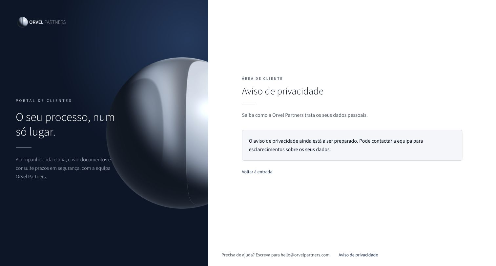

# Leitura do aviso antes do login — 18/11/2026

Atualização de 19/11: o [texto limpo 1.0](aviso-privacidade-2026-11-19.md) foi guardado como
rascunho na produção. A RPC pública continua a devolver aviso nulo. Não houve nova publicação
do frontend nem repetição do ensaio funcional descrito abaixo.

O portal passa a disponibilizar `/aviso-de-privacidade`, acessível pelos rodapés dos ecrãs de
entrada, sem pedir email ou sessão. A consulta é só de leitura e não confirma o aviso em
nome do visitante. `/privacidade` mantém a confirmação autenticada e o bloqueio de entrada
enquanto não existir aviso publicado/aplicável.

## Dados e publicação

- A RPC pública existente `get_org_public` inclui apenas o aviso em vigor da organização
  resolvida pelo domínio/slug. Usa `private.current_notice_id`, igual ao percurso autenticado.
- Rascunhos, versões futuras e avisos de outra organização não são selecionados. Os campos
  do aviso são limitados a ID, versão, corpo, data de publicação e substituição de prazo legada.
- Nenhuma tabela ganhou permissões anónimas; documentos e confirmações continuam privados.
- A migração `20261118190033_public_privacy_notice` foi instalada primeiro em testes e depois
  em produção. Os dois históricos foram alinhados com o ficheiro local, totalizando 16 migrações.
- O rascunho jurídico continua na revisão 9, sem aprovação nem publicação. A migração não
  insere/atualiza textos, prazos, consentimentos, documentos ou tarefas de eliminação.

## Verificação

- **106 testes de frontend:** leitura sem sessão, ligação no login, ausência de confirmação
  pública, aviso ausente, falha de rede com repetição, títulos/listas/negrito e HTML escapado.
  Um teste com `AuthProvider` real garante que o evento inicial anónimo não cancela a consulta.
- **453 verificações SQL em PGlite:** 16 novas verificações para o aviso público, incluindo
  seleção da versão, domínio/organização, ausência de rascunhos/futuras publicações,
  permissões de tabelas, confirmação ainda necessária e fila de eliminação vazia.
- Typecheck e build de produção concluídos. Mantém-se o aviso de tamanho do bundle já
  existente; não houve alteração de dependências nem inclusão de biblioteca Markdown.
- Chrome, demonstração local: entrada → ligação do aviso → texto de teste visível sem
  preenchimento de email nem sessão. Sem envio de mensagens ou uso de documentos reais.
- Produção: zero avisos publicados, zero documentos, zero tarefas em `private.document_purge_jobs`,
  sem extensão cron. Segredos e `RETENTION_ENABLED=false` preservados, sem nova leitura do valor.

## Advisors e limites

Os advisors antes/depois mantêm os mesmos avisos: RPC pública `get_org_public` com
SECURITY DEFINER (deliberada, campos limitados e testados), 20 RPCs autenticadas com
SECURITY DEFINER, RLS sem políticas na fila privada e proteção contra passwords comprometidas
desativada. Não foram silenciados avisos com concessões adicionais ou alterações de planos.
Esta verificação é do fluxo de leitura pública, não certificação integral de segurança.

- [RPC pública com SECURITY DEFINER](https://supabase.com/docs/guides/database/database-linter?lint=0028_anon_security_definer_function_executable)
- [RPCs autenticadas](https://supabase.com/docs/guides/database/database-linter?lint=0029_authenticated_security_definer_function_executable)
- [RLS sem política](https://supabase.com/docs/guides/database/database-linter?lint=0008_rls_enabled_no_policy)
- [Proteção de passwords](https://supabase.com/docs/guides/auth/password-security#password-strength-and-leaked-password-protection)

As seis respostas de negócio e as validações jurídicas/contratuais da
[folha de confirmações](confirmacoes-privacidade-2026-11-18.md) continuam pendentes.
Não foram contratados planos pagos, ativada eliminação nem aberto o portal a clientes reais.

## Correção durante a validação no Chrome

A primeira versão técnica deixou a consulta pendente quando o evento inicial de autenticação
limpava as consultas de sessão. A consulta do aviso passou para o prefixo de cache pública
`org`, preservado na limpeza. As consultas privadas continuam a ser removidas; os testes
de isolamento e logout mantêm-se a passar. Correção: commit `f5d6cd3798c72aeb842eb3039b2ce84e4ce8a460`.

## Resultado da publicação técnica

| Campo | Resultado |
|---|---|
| URL | https://portal.orvelpartners.com/aviso-de-privacidade |
| Destino | Production, projeto `prj_qGopqpbxJ08ClmkSGLFbasqrGQ0Z`, equipa `team_4UE4GPF895jF3QvZu1crnFMN` |
| Deployment | `dpl_QZ7ZQSVcNEEHjTJafiXv3M8RiwfZ`, **READY**, sem erro de alias |
| Commit | `f5d6cd3798c72aeb842eb3039b2ce84e4ce8a460` |
| Framework / build | Vite; build remoto de aproximadamente 13 segundos |
| Chrome | Página carregada no domínio final; apresenta «O aviso de privacidade ainda está a ser preparado» |
| Aviso jurídico | Zero versões publicadas em produção; texto de aprovação não foi carregado para a aplicação |

A verificação visual confirmou o estado final depois da correção, não apenas o estado READY.
O registo abaixo contém apenas a página pública e o contacto empresarial.

Observabilidade: consultas de erros/fatal do deployment anterior e do deployment final sem
registos na janela de 15 minutos consultada. Trata-se de uma aplicação estática que usa
Supabase; ausência de logs de funções Vercel não certifica toda a atividade do backend.
Não foram configurados drains ou ferramentas pagas de monitorização.
